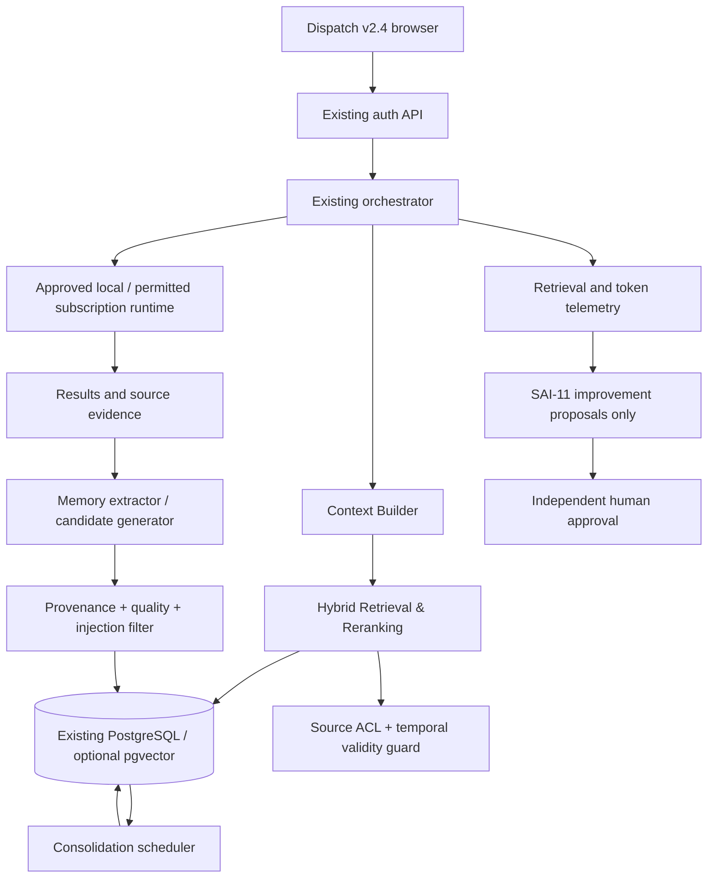

# Technical Architecture and Trust Boundaries

## Integration topology


## Authoritative model
PostgreSQL remains system of record. Store memory records, claims, links, permissions, provenance, time validity and feedback as additive versioned tables. `pgvector` is an optional index extension after deployment compatibility and benchmarks; Postgres FTS is the dependable first stage. Raw source artifacts remain in existing artifact storage with hash and immutable references. Derived embeddings, summaries and caches can always be rebuilt; none of them override canonical source facts.

## Write lifecycle
`source event` → permission check → immutable snapshot and digest → deterministic parsing where possible → candidate claims and type/status → source-anchored verification → duplicate/contradiction check → store under original project scope → optional embedding/index update → event/audit.

The extractor may return untrusted proposals; **it cannot create approved decisions**. Approved status is derived from authenticated product approval/decision events, not from an LLM description. The extractor must not ingest secrets, raw protected credentials or unconsented conversations.

## Read lifecycle
`authorized task` → determine tenant/project/time scope, purpose and eligible sensitivity → retrieve lexical + (if enabled) vector candidates → authoritative ACL check before and after ranking → validate source freshness/status → dedup, merge and score → select under per-role token budget → produce cited manifest with omissions/uncertainty → run model. Retrieval must fail closed if ACL or snapshot validity cannot be checked.

## Retrieval design
- Candidate retrieval: PostgreSQL full-text search + approximate semantic search when enabled, combine using reciprocal-rank fusion as an initial deterministic baseline.
- Scope: project_id + tenant_id + requester role + source ACL + current valid time. Cross-project reuse **disabled by default** and opt-in with explicit source sharing grants.
- Ranking: topical relevance, verified/approved authority, temporal validity, compatibility, diversity and user relevance. Do not make unsupported numeric confidence claims.
- Exclude deleted and superseded records from authoritative current-knowledge packs; optionally show historical evidence in explicitly historical tasks.
- Always preserve a protected allocation for direct source documents and current user instructions; retrieved memory is **data**, never system instructions.
- Query expansions/LLM reranking require permitted runtime and are disabled unless quality evidence justifies them.

## Consolidation
Merge duplicate records only if compatible source, identity, scope and claim semantics are established. Create versioned summaries linked to all constituent source record IDs/hashes. Maintain reversible lineage; conflicting facts remain explicitly conflicting. Decay retrieval priority with staleness, **not** delete by confidence heuristics. Explicit retention/deletion is policy- and user-driven.

## Context budgeting
At job start compute `max_input_tokens` from role/runtime/approved limits and reserve: system/tool instructions, current request, direct task source, working-state carryover, retrieved memory and safety margin. Measure actual tokenizer when supported; otherwise conservative estimator. Emit manifest `context_pack_id`, version, exact source ids/digests, retrieval filter, reason, token estimates/actual, scope and model config. Reject over-budget context rather than arbitrary unsafe truncation; use source-preserving staged expansion as needed.

## SAI-11 boundary
Memory quality feedback may spawn hypotheses, versioned search/config/skill candidates and isolated A/B evaluation. SAI-11 has **no** registry promotion, policy, deployment, or source-approval write authority. Promotion requires the same exact-digest human approval and validated tests as v2.2.

## Proposed additive code layout (verify repo first)
```
packages/memory/
  src/{domain,ingest,retrieve,consolidate,context,feedback,security}/
  tests/{unit,integration,adversarial}/
packages/db/migrations/*memory*.sql
apps/api/src/routes/memory/*
apps/web/src/components/memory/*
```
Reuse existing ORM, policies, background jobs, event stream and API style. Do not create a second scheduler, database or auth system.

## Failure states
Index unavailable → bounded lexical-only fallback if ACL and freshness checks remain valid; otherwise block. Embedding model unavailable → queue indexing and permit authorized lexical retrieval. Source withdrawn/deleted → invalidate derived indexes and packs immediately; drain running requests according to policy. Missing trustworthy source → ask for source or abstain, never generate a fabricated memory.
